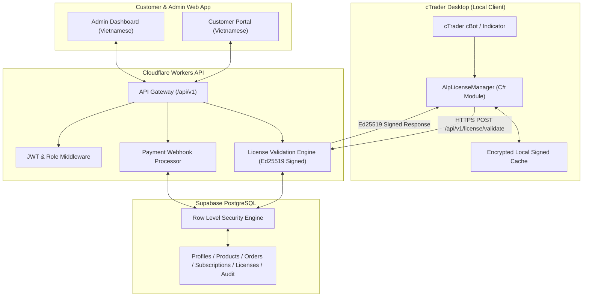

# ALP – Algo License Platform: Architecture

## 1. Tổng quan Kiến trúc

ALP (Algo License Platform) được thiết kế theo mô hình Microservices / Modular Monolith phân tách rõ ràng giữa:
1. **Frontend Application (`apps/web`)**: Giao diện người dùng hướng tới thị trường tài chính, 100% tiếng Việt, phát triển trên React, Vite, Tailwind CSS, shadcn/ui.
2. **Backend API (`apps/api`)**: Edge API chạy trên Cloudflare Workers, xử lý xác thực license tốc độ cao (<50ms toàn cầu), ký số bất đối xứng Ed25519, điều phối thanh toán và phân quyền.
3. **Database Layer (`supabase/`)**: PostgreSQL quản lý dữ liệu giao dịch, tài khoản cTrader, thuê bao, license hash, audit log với Row Level Security (RLS) nghiêm ngặt.
4. **Trading Client Integration (`ctrader/AlpLicenseManager`)**: Thư viện C# chuẩn hóa nhúng trực tiếp vào cBots và Indicators trên cTrader Desktop.

## 2. Các phân hệ chính (Modules)

### Module A: Customer Website
- Trang chủ giới thiệu sản phẩm giao dịch tự động.
- Danh mục sản phẩm (cBots, Indicators, Bundles).
- Chi tiết sản phẩm, bảng giá và chu kỳ thanh toán.
- Đăng ký, đăng nhập tài khoản khách hàng.
- Cổng thanh toán và tạo đơn hàng.
- Trung tâm khách hàng: quản lý tài khoản cTrader, xem license, gia hạn và tải file `.algo`.

### Module B: Admin Dashboard
- Thống kê doanh thu, số lượng license kích hoạt, phiên bản cBot.
- Quản lý danh mục sản phẩm và gói giá.
- Quản lý khách hàng, phân quyền (customer, support, admin, super_admin).
- Quản trị license: Kích hoạt, Tạm ngưng (Suspend), Thu hồi (Revoke), Gia hạn (Extend), Chuyển đổi tài khoản (Rebind).
- Nhật ký hệ thống (Audit Logs) và sự kiện bản quyền (License Events).

### Module C: Subscription Engine
- Tự động kích hoạt gói thuê bao ngay sau khi xác nhận thanh toán webhook thành công.
- Tính toán ngày hết hạn chính xác theo UTC.
- Xử lý gia hạn: nếu gói còn hạn thì cộng dồn ngày; nếu đã hết hạn thì tính từ thời điểm gia hạn.
- Xử lý hủy gói: giữ nguyên quyền truy cập đến hết ngày đã thanh toán.

### Module D: License Engine
- Sinh mã license ngẫu nhiên độ dài cao (high entropy).
- **Tuyệt đối không lưu mã thô**: chỉ lưu `SHA-256` hash và tiền tố hiển thị (ví dụ `ALG-8X7F-****`).
- Ràng buộc partial unique index: không bao giờ giới hạn vĩnh viễn cặp `(product_id, trading_account_id)` để người dùng có thể mua lại sau khi hết hạn.
- Ký số asymmetric Ed25519 trên mọi payload phản hồi thành công.

### Module E: Payment Engine
- Kiến trúc Adapter đa cổng thanh toán (VietQR, SeAPay, Stripe, Crypto).
- Kiểm tra tính xác thực của chữ ký webhook (HMAC/Ed25519).
- Đảm bảo tính Idempotency: bảng `payment_events` lưu `(provider, provider_event_id)` duy nhất để loại bỏ webhook trùng lặp.

### Module F: cTrader Integration
- Thư viện C# `AlpLicenseManager` tương thích cTrader Automate.
- Xác thực và gửi heartbeat định kỳ.
- Bộ nhớ đệm (cache) phản hồi có chữ ký kèm cơ chế Grace Period an toàn khi mạng chập chờn.
- **Nguyên tắc an toàn giao dịch**: Khi license hết hạn, cBot TUYỆT ĐỐI KHÔNG đóng ồ ạt toàn bộ lệnh đang mở của khách hàng; chỉ dừng mở lệnh mới và duy trì quản lý Stop Loss / Take Profit.

